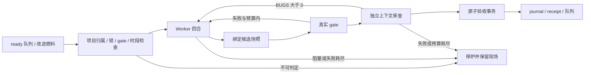

# Agent harness 契约

CodingKeeper 的 harness 有两层：产品运行时约束编码 Agent 的执行与验收；仓库测试体系验证这个运行时本身。两层共用原则：结论来自可核对的证据，失败和跳过必须可见，无法确认的候选保留给人核对。

开发工作流见 [CONTRIBUTING](../CONTRIBUTING.md)，运行操作见 [OPERATIONS](OPERATIONS.md)，测试命令见 [tests/README](../tests/README.md)，状态恢复见 [STATE-CONTRACTS](STATE-CONTRACTS.md)。

## 运行闭环

| 边界 | 输入与成功条件 | 失败处理与证据 |
|---|---|---|
| 任务 | `queue.md` 的 `## ready` 未勾选项及缩进续行；任务合同应有差距、范围、验收命令 | `blocked` / `review-needed` 不自动提升；队列外部改写导致验收冲突则停住 |
| 前置 | 物理项目路径、runner 所有权锁、真实 Git 项目和 gate；人工 halt、占用、窗口与 quota 检查 | 无法核验归属、占位门禁或坏状态不启动工作；保留状态供排障 |
| Worker | TUI 的本轮新鲜完成事件或 headless 进程结果；任务标记仅允许进入下一阶段 | 退出/超时/空响应/阻塞由适配器分类；Worker 自述不能直接验收 |
| 候选 | 基线、候选及包括 Worker 提交在内的文件清单和指纹 | 验证期间候选变动拒绝验收；失败不丢弃用户或 Worker 的工作 |
| Gate | 项目维护者配置的 `.codingkeeper/gate.sh` 真实退出码 | 输出回灌且受重试/超时预算限制；SKIP 不提供被跳过能力的通过证据 |
| Review | 新的独立上下文成功响应，最终非空行 `BUGS: <n>`；默认连续两份成功零 bug | 非零退出、缺标记、空输出或超时不能当作零 bug；发现问题重置收敛计数 |
| 验收 | 锁内复核候选，用可恢复事务关联 queue、journal 和 receipt | 未完成事务可幂等恢复；外部修改与事务冲突时停止，不手工补 done 绕过 |
| 观察 | `status.json`、心跳、watch 日志、evidence 和晨报 | 等待不冒充 active；receipt 数量不能单独代表产品价值 |

独立审查保证上下文独立，不保证底层模型不同。默认 `auto` 审查车道直接选 Codex，不做付费探针或渠道回退。审查的只读工具限制与 OS 隔离能力取决于适配器，见 [工具矩阵](TOOLS.md) 与 [叶子审计](LEAF-AUDIT-2026-11-05.md)。

## 两条执行通道

TUI：`ck codex` / `ck claude` / `ck pi` / `ck opencode` 经 `codexc` 创建或附着私有项目 tmux 会话，`codexc-loop` 驱动队列，工具特定 watcher 处理瞬时错误。只消费本轮、归属明确的完成信号；quota 不发送盲目 continue。

Headless：`ck zcode run` / `ck dsh run` 经 `codexc-headless` 启动阻塞子进程。适配器解析结构化事件、保存会话 ID 并校验项目归属；恢复失败不能静默新建上下文。ZCode 的目录迁移必须同时处理持久化 cwd 和侧栏，见 [迁移清单](LOCAL-RENAME-2026-11-14.md)。

共享语义维护在 `ck-common.sh` / `ck-leaf.py`。通道共用任务目录与验收语义，但 TUI 回合事件、headless 进程监督和时段处理有各自实现，不能用一条通道的测试证明另一条已覆盖。

## 代码地图

| 职责 | 当前实现 |
|---|---|
| 产品路由、启动与定时 | `ck`、`codexc`、`zcodec`、`dshc`、`codexc-daily` |
| Runner 与初始化 | `codexc-loop`、`codexc-headless`、`ck-init-furnace` |
| 共享锁、队列、gate、review、状态、登记 | `ck-common.sh` |
| 快照、指纹、验收事务与证据保留 | `ck-leaf.py` |
| 队列离线结构核对 | `ck-leaves.py` |
| 工具会话与协议 | `codexc-zcode-worker`、`codexc-dsh-worker`、`ck-zcode-session.py`、`ck-dsh-session.py` |
| 审查最终响应与进程监督 | `codexc-review-leaf`、`ck-review-process.py` |
| 错误续命、provider 恢复与空闲交接 | `ck-watcher.py`、`ck-watch-tools.sh`、`ck-provider.py`、`ck-tool-supervisor.py`、`ck-night-loop.py` |
| 时段、人工占用、配置和日志 | `ck-window.py`、`ck-interaction.py`、`ck-config.py`、`ck-log.py` |
| 燃料、领域包、晨报与趋势 | `ck-prompts.py`、`ck-fuel-packs.py`、`ck-morning.py`、`ck-quality-trend.py` |
| 全局看门狗、部署与桌面 | `burn-watch.sh`、`ck-watchdog-alive.sh`、`packaging/`、`desktop/CodingKeeperBar.swift` |
| 测试计划、执行和隔离 | `tests/harness.py`、`tests/run-all`、`tests/isolate.py` |

## 测试 harness 的合同

`tests/run-all` 是统一入口。Python 计划器先校验选择器，`--help` / `--list` 无需 tmux 或隔离目录；正式执行由 isolator 创建私有 HOME、tmux socket、临时目录和进程组，Bash 3.2 runner 按选定阶段执行。integration 的四个 TUI 世界并行，headless 随后执行；阶段失败后仍收集其余结果，最终退出非零。

Audit 套件从 `tests/*-audit.py` 自动发现并排序，不再依赖人工登记。命名错误或放错目录不会被发现；新增测试后用 `--list` 核对。可选原生 TTY 与基准脚本单独列为 manual，不自动调用真实 CLI 或计为离线回归通过。

每个检查记录阶段、名称、退出码、耗时、日志路径、可识别的 SKIP 提示。`report.json` 原子更新，结束前核对预计检查是否齐全；isolator 最后补记清理结果。取消保留非零退出与已有证据；清理失败不能把失败转换成通过。成功默认删除 scratch world，失败保留；需要完整成功日志时使用 `--keep-artifacts`，跨清理保留报告时指定 `--report`。

`pass_with_skips` 表示命令成功且存在未覆盖项；`keys` 是本地库存报告。`--strict-skips` 将已识别 SKIP 变成整体失败。跳过识别覆盖标准 `SKIP:` 行及 unittest skipped 汇总，并不是任意输出格式的通用测试结果解析器。

## 人工验收与真实调用

完整离线通过仍不能证明真实认证、未知 GUI 弹窗、真实 TTY、当前安装桌面二进制、摄像头/麦克风、浏览器与未来 CLI 协议可用。这些能力按 [发布流程](RELEASE.md) 记录环境、步骤、实际观察和结论；未执行项明确写未验证。

改进工单应描述用户结果，验证同一回归在修复前失败、修复后通过，并回到用户看到的界面确认。性能结论需要同负载 before/after；模型或商业结论需要对应真实证据。历史反例与边界见 [执行质量审计](AUDIT-EXECUTION-QUALITY-2026-11-15.md)。
